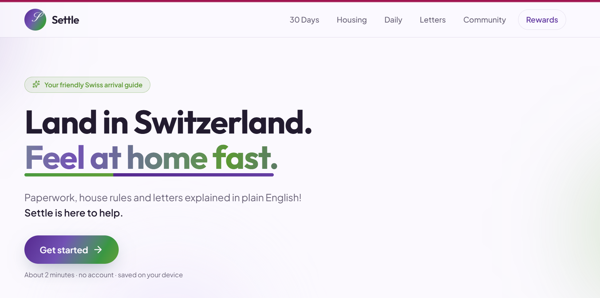
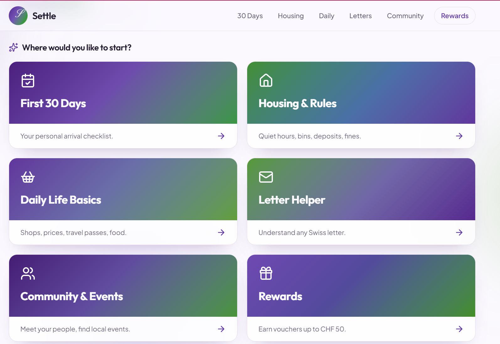

# Settle

**Product thinking meets AI assisted development.**

With five years of professional experience, I approach product development by starting with the user problem, defining the right solution, and translating ideas into meaningful experiences.

Settle is a working prototype designed to help people navigate their first weeks in Switzerland, from administrative requirements and housing to everyday essentials and official letters.

I defined the problem, shaped the product scope, prioritised the core features, and used Lovable to turn the concept into an interactive application. I also presented the idea at a digital transformation session in Geneva and received feedback to inform future iterations.

This project reflects how I approach AI product management: think strategically, build with purpose, and use AI to move from idea to prototype faster.

**[Explore the live prototype] : - https://settle-in-swiss-guide.lovable.app/
## Product preview

### Homepage

### Features

### Ask Buddy

### Onboarding details

## The problem

Moving to a new country means navigating unfamiliar processes, administrative deadlines, housing rules, and official letters. Finding reliable, relevant information can quickly become overwhelming.

Settle aims to make this transition simpler by bringing essential guidance into one accessible place.

## The product

**First 30 Days**

A personalised checklist covering key onboarding tasks and deadlines.

**Housing and Local Rules**

Practical guidance on renting, recycling, quiet hours, and local requirements.

**Daily Life Basics**

An introduction to supermarkets, public transport, and everyday costs.

**Letter Helper**

AI assisted explanations of official letters in plain English, with privacy controls before submission.

**Ask Buddy**

A context aware AI assistant that helps users navigate questions as they explore the app.

## My approach

Before building, I worked through the core product questions:

1. Who is the user, and what problem are they facing?
2. What information matters most during the first 30 days?
3. Which features would make the experience genuinely useful?
4. How can the user experience make an overwhelming process feel simpler?
5. What belongs in the first version, and what can wait?

I used these decisions to shape the initial scope and guide the prototype's development with Lovable.

## What I explored

Product discovery, MVP scoping, feature prioritisation, UX thinking, AI assisted prototyping, and feedback driven iteration.

The prototype was presented during a digital transformation session in Geneva, where conversations and feedback helped identify opportunities for further development.

## Built with

Lovable, React, TanStack Start, Tailwind CSS, and OpenAI through Lovable's AI gateway.

## Current scope

The prototype is English only. Detailed local guidance currently covers Zurich, Geneva, and Vaud, with general guidance for other cantons.

AI generated responses provide practical guidance, not legal advice. Voucher rewards are part of the concept and do not have automatic payouts.

## What's next

Validate the most useful features with users, incorporate feedback, and improve the accuracy and coverage of local guidance.
